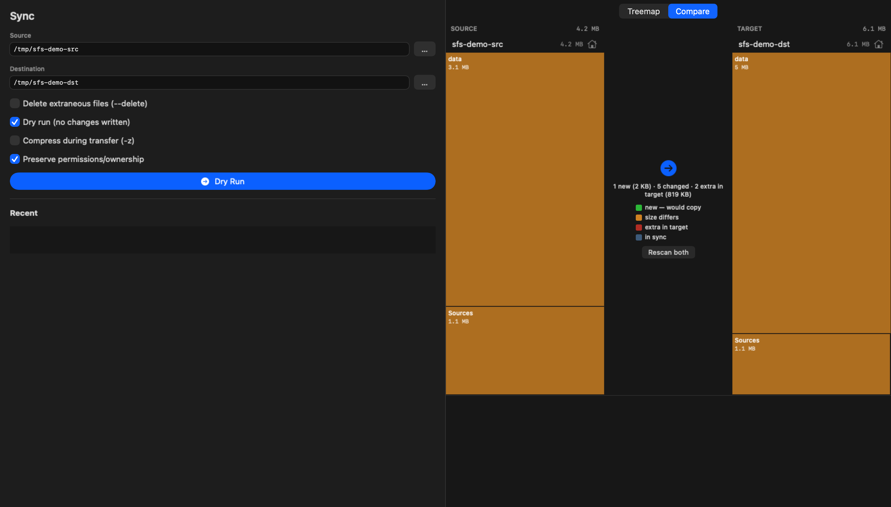

# Simple File Sync

A lightweight macOS app that wraps `rsync` in a clean SwiftUI interface — with an
integrated file-size treemap so you can *see* what a sync will do before you run it.



## Features

- **One-click rsync** — pick source and destination, toggle options (delete extras,
  dry run, compression, preserve permissions), hit Sync. Dry run is on by default.
- **File-size treemap** — every folder is a tile sized proportionally to the bytes
  it holds. Click to drill in, breadcrumb to climb back out.
- **Compare mode** — source and target rendered side by side, color-coded by sync
  state:
  - 🟩 green — new, would be copied
  - 🟧 orange — exists on both sides, size differs
  - 🟥 red — extra in target (would be deleted with `--delete`)
  - 🟦 blue — in sync
- **Live progress** — real-time file counter while scanning, rsync log with
  percent-complete parsing.
- **Works with openrsync** — detects Apple's openrsync vs GNU rsync at runtime and
  adapts flags accordingly.

## Requirements

- macOS 14+
- Swift 5.10+ / Xcode 16+ to build

## Build & run

```sh
swift run
```

Or build a release binary:

```sh
swift build -c release
.build/release/SimpleFileSync
```

## Headless / CLI modes

The binary doubles as a diagnostic tool:

```sh
# Run a real sync, print log + exit code
.build/debug/SimpleFileSync --sync-test <src> <dst>

# Print a folder scan summary
.build/debug/SimpleFileSync --scan-test <path>

# Render the UI to a PNG without opening a window
.build/debug/SimpleFileSync --snapshot <out.png> <src> <dst> [--compare]
```

## Architecture

Single SwiftPM executable target, no third-party dependencies:

| File | Role |
|------|------|
| `SimpleFileSyncApp.swift` | App entry, headless snapshot/test modes |
| `ContentView.swift` | Sidebar (sync controls) + Treemap/Compare modes |
| `Models.swift` | `TreeNode`, `SyncOptions`, rsync argument builder |
| `FolderScanner.swift` | Concurrent recursive scan with live progress |
| `RsyncRunner.swift` | `Process` wrapper, GNU/openrsync compatibility |
| `TreemapView.swift` | Squarify treemap layout + drill-down |
| `Diff.swift` | Directory-tree diff used by Compare mode |

## License

MIT
